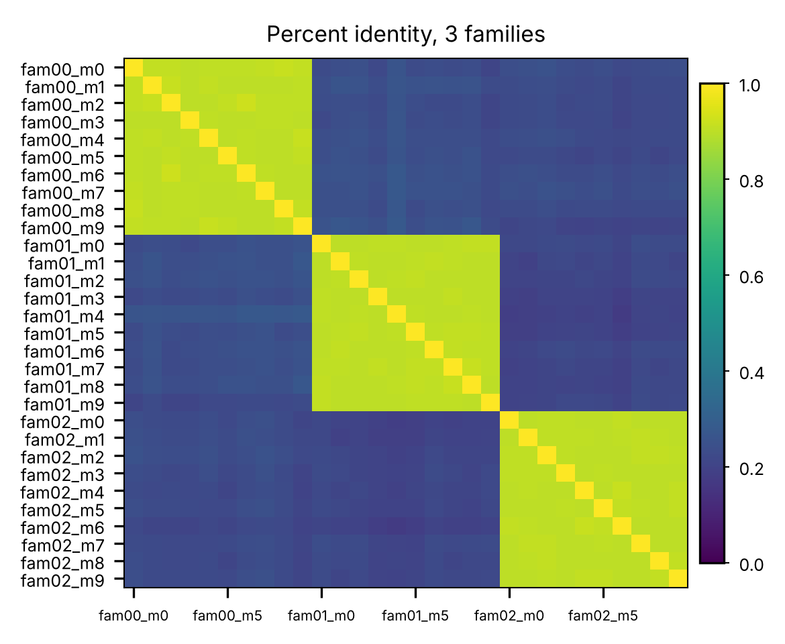

# Leakage in biological data

## Learning goals

After this module, you should be able to:

1. Explain why a random split can overstate performance on biological data.
2. Design a split that matches the question a model will be used to answer.
3. Identify leakage when reading a paper's methods.

## Introduction

In the last module, we used a test set to measure how well a model made
predictions on new data. Because the data points were generated independently,
we could randomly split them into training, validation, and test sets.

But biological data are often related. Genes belong to families, individuals
share ancestry, and multiple observations may come from the same animal. If
related examples appear in both the training and test sets, the model may
perform well by recognizing patterns it has already seen rather than learning
something that generalizes to new data.

This is a form of data leakage. Information about the test examples is already
present in the training data, so test performance may overestimate how well
the model will perform on genuinely new examples.

## Data

We generate 40 families of DNA sequences. Each family starts from one random
200 bp ancestor, and each of its 10 members is a copy of the ancestor with 5%
of the bases mutated. Members of a family are about 90% identical. Sequences
from different families are no more alike than random sequences.



<details>

```bash
python src/make_family_dataset.py \
    --label_rule family \
    --out out/fam_random_label.tsv
wrote out/fam_random_label.tsv: 40 families x 10 members, 50.0% label 1

python src/pairwise_identity.py \
    -i out/fam_random_label.tsv \
    --families fam00 fam01 fam02 \
    -o out/identity.tsv
mean identity within a family:  0.904
mean identity between families: 0.226

python src/plot_matrix.py \
    -i out/identity.tsv \
    --row_labels \
    --col_labels \
    --cmap viridis \
    --vmin 0 \
    --vmax 1 \
    --colorbar \
    --width 4 \
    --height 3.3 \
    --every_col 5 \
    --title "Percent identity, 3 families" \
    -o img/identity.png
```

</details>

We make two versions of the labels. The first has no rule that can generalize
to new families. The second has a sequence motif that the model can learn.

- Family labels. Each family gets a coin-flip label, 0 or 1, and every member
  shares it. Nothing in the sequence causes the label. There is no rule to
  learn, so a model that truly generalizes should get 50% on new sequences.
- Motif labels. A sequence is labeled 1 if it contains the motif `TATAAA`. We
  plant the motif in the ancestor of about half of the families. Some members
  lose it to mutation. This is a real rule that applies to any sequence.

## Model

The model is logistic regression on 6-mer frequencies. Each sequence becomes
a vector of 4,096 numbers, the fraction of its 6-mers that are `AAAAAA`,
`AAAAAC`, and so on. The model learns one weight per 6-mer. It is the same
logistic regression from the regression lecture with 4,096 inputs instead of
one, trained with binary cross-entropy and gradient descent.

With 4,096 weights and 300 training sequences, this model has plenty of room
to memorize.

## Two splits

We split the same data two ways, holding out a quarter for testing each time.

- By sequence. Shuffle the 400 sequences and hold out 100. Nearly every test
  sequence has close relatives in the training set.
- By family. Shuffle the 40 families and hold out 10. No test sequence has a
  relative in the training set.

| Labels | Split | Families on both sides | Train accuracy | Test accuracy | Baseline |
|-|-|-|-|-|-|
| family (no rule) | by sequence | 36 | 1.000 | 1.000 | 0.510 |
| family (no rule) | by family   | 0  | 1.000 | 0.550 | 0.500 |
| motif            | by sequence | 36 | 1.000 | 0.920 | 0.560 |
| motif            | by family   | 0  | 1.000 | 0.720 | 0.610 |

The baseline is the accuracy of always guessing the most common label in the
test set.

With family labels there is no rule that generalizes to new families, yet the
random split reports perfect test accuracy. The model learned which 6-mers
mark each family and recalled the label. Split by family, the same model
scores 0.55, about what a coin flip gets. The model achieved perfect test
accuracy even though there was no relationship it could learn that would
generalize to new families. The random split allowed it to recognize
sequences from families it had already seen.

With motif labels there is something real to learn, and the family split
still beats its baseline, 0.72 against 0.61. But the random split reports
0.92. Part of that 0.92 is the motif and part is family recall, and from the
random split alone there is no way to tell how much is which.

For this demonstration, we report test accuracy during training to show how
the two splits behave. In a real model development workflow, we would use
validation data to make training decisions and reserve test data for the
final evaluation.

<details>

```bash
python src/make_family_dataset.py \
    --label_rule motif \
    --out out/fam_motif_label.tsv
wrote out/fam_motif_label.tsv: 40 families x 10 members, 37.2% label 1

for d in fam_random_label fam_motif_label; do
    for by in sequence family; do
        echo "== $d $by"
        python src/split_data.py \
            -i out/$d.tsv \
            --by $by \
            -o out/$d.by_$by

        python src/train_kmer_logistic.py \
            --train out/$d.by_$by.train.tsv \
            --test out/$d.by_$by.test.tsv \
            --k 6
    done
done
== fam_random_label sequence
train: 300 sequences from 40 families
test:  100 sequences from 36 families
families on both sides: 36
epoch 0000 train_acc=0.497 test_acc=0.510
epoch 0010 train_acc=1.000 test_acc=1.000
epoch 0100 train_acc=1.000 test_acc=1.000
epoch 0500 train_acc=1.000 test_acc=1.000
epoch 1000 train_acc=1.000 test_acc=1.000
epoch 2000 train_acc=1.000 test_acc=1.000
baseline (always guess the most common test label): 0.510
== fam_random_label family
train: 300 sequences from 30 families
test:  100 sequences from 10 families
families on both sides: 0
epoch 0000 train_acc=0.500 test_acc=0.500
epoch 0010 train_acc=1.000 test_acc=0.550
epoch 0100 train_acc=1.000 test_acc=0.550
epoch 0500 train_acc=1.000 test_acc=0.550
epoch 1000 train_acc=1.000 test_acc=0.550
epoch 2000 train_acc=1.000 test_acc=0.550
baseline (always guess the most common test label): 0.500
== fam_motif_label sequence
train: 300 sequences from 40 families
test:  100 sequences from 36 families
families on both sides: 36
epoch 0000 train_acc=0.350 test_acc=0.440
epoch 0010 train_acc=1.000 test_acc=0.900
epoch 0100 train_acc=1.000 test_acc=0.920
epoch 0500 train_acc=1.000 test_acc=0.910
epoch 1000 train_acc=1.000 test_acc=0.910
epoch 2000 train_acc=1.000 test_acc=0.920
baseline (always guess the most common test label): 0.560
== fam_motif_label family
train: 300 sequences from 30 families
test:  100 sequences from 10 families
families on both sides: 0
epoch 0000 train_acc=0.367 test_acc=0.390
epoch 0010 train_acc=1.000 test_acc=0.710
epoch 0100 train_acc=1.000 test_acc=0.720
epoch 0500 train_acc=1.000 test_acc=0.720
epoch 1000 train_acc=1.000 test_acc=0.720
epoch 2000 train_acc=1.000 test_acc=0.720
baseline (always guess the most common test label): 0.610
```

</details>

## Which split is right?

Neither split is wrong in general. The right split is the one that matches how
the model will be used.

If the model will only ever be applied to new members of families it was
trained on, a random split measures that. If it will be applied to genes,
species, individuals, or recording sites it has never seen, the test set has to
hold out whole genes, species, individuals, or sites. The split needs to match the kinds of new examples we expect the model to
predict.

Some groupings to look for.

| Data | Related examples | Hold out by |
|-|-|-|
| Protein or DNA sequences | gene families, homologs | sequence identity clusters |
| Variants | variants in the same gene or position | gene, or chromosome |
| Genomic regions | overlapping or nearby windows | chromosome |
| Enhancer-promoter pairs | pairs sharing an enhancer or promoter | genomic region |
| Individuals | relatives, shared ancestry | family, population |
| Animal recordings | calls from the same individual, session, or site | individual, session, site |

Xi and Beer (2018) is a published example. Earlier models predicting which
enhancers contact which promoters reported high accuracy with random splits.
Because the same enhancers and promoters appeared in many pairs, the models
could learn which elements tend to be in contacts without learning anything
about the pairing. When the split held out whole regions of the genome,
performance dropped sharply.

## Questions

1. We used 6-mer frequencies to train our model. What happens if we use
   3-mers instead? Rerun the motif-label experiment with `--k 3`.

   ```bash
   for by in sequence family; do
       python src/train_kmer_logistic.py \
           --train out/fam_motif_label.by_$by.train.tsv \
           --test out/fam_motif_label.by_$by.test.tsv \
           --k 3
   done
   ```

   Compare the test accuracy for the two splits to the original results.
   Which changed more? Why might changing the k-mer size affect the model's
   ability to recognize related sequences?

2. In our original dataset, members of a family differed from their ancestor
   at 5% of positions. What happens if sequences within a family become less
   similar? Generate datasets with divergence values of 0.2 and 0.5 and
   repeat the family-label experiment using a random sequence split.

   ```bash
   for div in 0.2 0.5; do
       python src/make_family_dataset.py \
           --label_rule family \
           --divergence $div \
           --out out/fam_div$div.tsv

       python src/split_data.py \
           -i out/fam_div$div.tsv \
           --by sequence \
           -o out/fam_div$div

       python src/train_kmer_logistic.py \
           --train out/fam_div$div.train.tsv \
           --test out/fam_div$div.test.tsv \
           --k 6
   done
   ```

   How did test accuracy change as sequence divergence increased?
   What does this tell us about the relationship between sequence
   similarity and data leakage?

3. Find a published study that used machine learning to make predictions from
   biological data. How did the authors split their training and test data?
   Were there related examples that could have appeared in both sets? Would
   you have used the same split?  Explain why or why not.
