# Overfitting

## Learning goals

After this module, you should be able to:

1. Explain the difference between fitting a model to training data and making
   predictions on new data.
2. Use a validation set to recognize when a model is overfitting.
3. Explain how early stopping and L2 regularization help prevent overfitting.
4. Explain why the test set should only be used for the final evaluation of a
   model.

## Introduction

With linear regression, gradient descent finds the line that best fits the
data. When the data contain noise, the model will fit some of that noise,
producing a line that differs from the one that actually generated the data.

For example, if we generate data from the line $y=0.5x+3$ with varying levels
of noise, we can see that the fitted line moves further from the true line.

| Noise | Fit | Plot|
|-|-|-|
| 0 | $w=0.493$ $b=3.049$ | 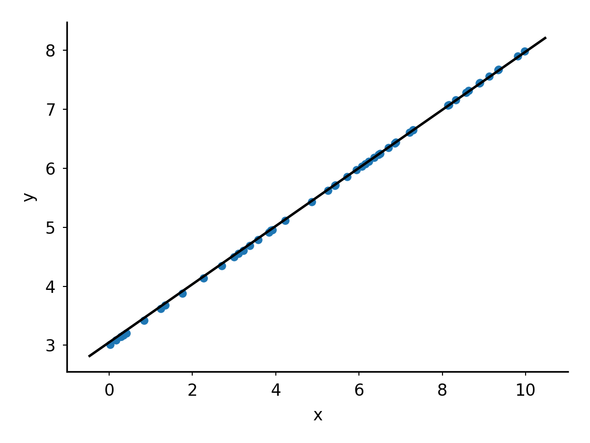 |
| 1 | $w=0.545$ $b=2.809$ | 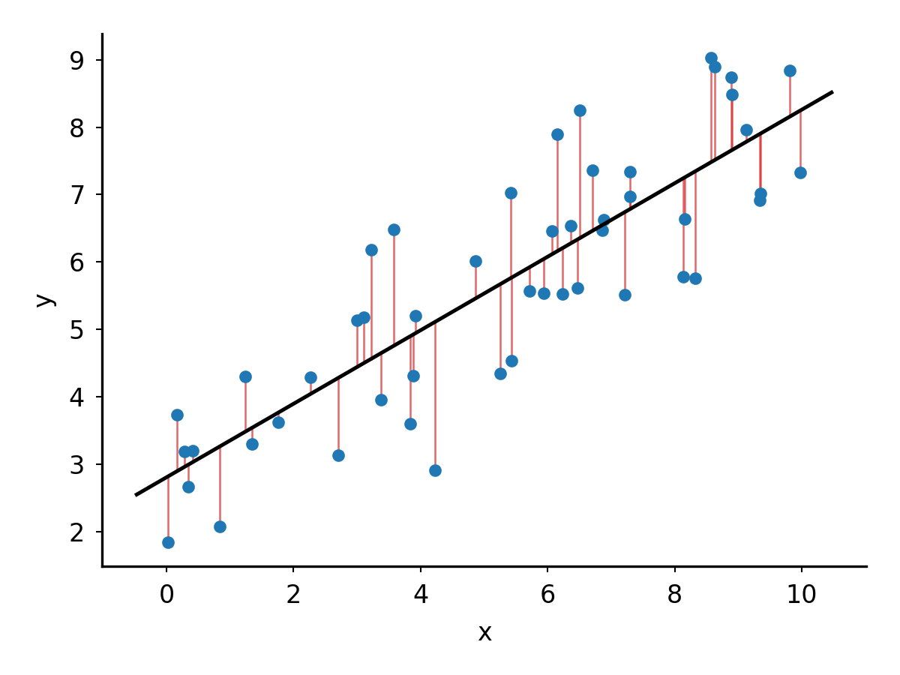 |
| 5 | $w=0.753$ $b=1.848$ | 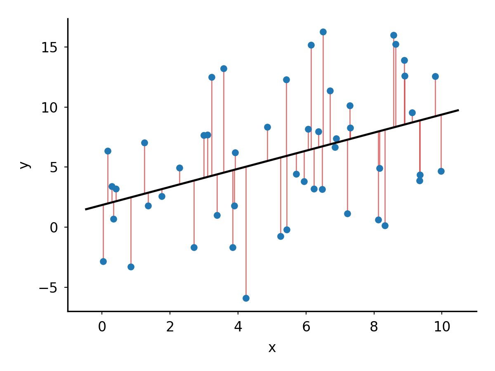 |

<details>

```bash
python src/make_line_dataset.py \
    --w 0.5 \
    --b 3 \
    --noise 0 \
    --out out/line_0.5x_3_no_noise.tsv

python src/train_line.py \
    --data out/line_0.5x_3_no_noise.tsv \
    --out_prefix out/line_0.5x_3_no_noise
epoch 0000 mse=25.0000 w=+0.500 b=+8.000 dL/dw=+52.684 dL/db=+10.000
epoch 0001 mse=9.9950 w=-0.554 b=+7.800 dL/dw=-25.815 dL/db=-1.502
epoch 0002 mse=6.4489 w=-0.037 b=+7.830 dL/dw=+11.934 dL/db=+3.998
epoch 0005 mse=5.1343 w=-0.202 b=+7.672 dL/dw=-1.676 dL/db=+1.946
epoch 0010 mse=4.6704 w=-0.152 b=+7.464 dL/dw=-0.265 dL/db=+2.054
epoch 0020 mse=3.8839 w=-0.095 b=+7.071 dL/dw=-0.273 dL/db=+1.868
epoch 0050 mse=2.2336 w=+0.048 b=+6.087 dL/dw=-0.207 dL/db=+1.417
epoch 0100 mse=0.8883 w=+0.215 b=+4.947 dL/dw=-0.131 dL/db=+0.893
epoch 0200 mse=0.1405 w=+0.387 b=+3.774 dL/dw=-0.052 dL/db=+0.355
epoch 0300 mse=0.0222 w=+0.455 b=+3.308 dL/dw=-0.021 dL/db=+0.141
epoch 0500 mse=0.0006 w=+0.493 b=+3.049 dL/dw=-0.003 dL/db=+0.022
wrote out/line_0.5x_3_no_noise.params.tsv

python src/plot_fit.py \
        --data out/line_0.5x_3_no_noise.tsv \
        --w 0.493 \
        --b 3.049 \
        --residuals \
        -o img/line_0.5x_3_no_noise.residuals.png \
        -x x \
        -y y

python src/make_line_dataset.py \
    --w 0.5 \
    --b 3 \
    --noise 1 \
    --out out/line_0.5x_3_1_noise.tsv

python src/train_line.py \
    --data out/line_0.5x_3_1_noise.tsv \
    --out_prefix out/line_0.5x_3_1_noise
epoch 0000 mse=25.6858 w=+0.500 b=+8.000 dL/dw=+51.445 dL/db=+9.934
epoch 0001 mse=11.3496 w=-0.529 b=+7.801 dL/dw=-25.244 dL/db=-1.305
epoch 0002 mse=7.9503 w=-0.024 b=+7.827 dL/dw=+11.635 dL/db=+4.067
epoch 0005 mse=6.6525 w=-0.184 b=+7.663 dL/dw=-1.660 dL/db=+2.058
epoch 0010 mse=6.1429 w=-0.133 b=+7.445 dL/dw=-0.280 dL/db=+2.156
epoch 0020 mse=5.2757 w=-0.073 b=+7.032 dL/dw=-0.287 dL/db=+1.962
epoch 0050 mse=3.4561 w=+0.078 b=+5.999 dL/dw=-0.218 dL/db=+1.488
epoch 0100 mse=1.9728 w=+0.253 b=+4.802 dL/dw=-0.137 dL/db=+0.938
epoch 0200 mse=1.1483 w=+0.433 b=+3.570 dL/dw=-0.055 dL/db=+0.373
epoch 0300 mse=1.0179 w=+0.505 b=+3.081 dL/dw=-0.022 dL/db=+0.148
epoch 0500 mse=0.9940 w=+0.545 b=+2.809 dL/dw=-0.003 dL/db=+0.023
wrote out/line_0.5x_3_1_noise.params.tsv

python src/plot_fit.py \
        --data out/line_0.5x_3_1_noise.tsv \
        --w 0.545 \
        --b 2.809 \
        --residuals \
        -o img/line_0.5x_3_1_noise.residuals.png \
        -x x \
        -y y

python src/make_line_dataset.py \
    --w 0.5 \
    --b 3 \
    --noise 5 \
    --out out/line_0.5x_3_5_noise.tsv

python src/train_line.py \
    --data out/line_0.5x_3_5_noise.tsv \
    --out_prefix out/line_0.5x_3_5_noise
epoch 0000 mse=48.7837 w=+0.500 b=+8.000 dL/dw=+46.489 dL/db=+9.668
epoch 0001 mse=36.9594 w=-0.430 b=+7.807 dL/dw=-22.958 dL/db=-0.515
epoch 0002 mse=34.1053 w=+0.029 b=+7.817 dL/dw=+10.440 dL/db=+4.343
epoch 0005 mse=32.8491 w=-0.109 b=+7.629 dL/dw=-1.598 dL/db=+2.506
epoch 0010 mse=32.1340 w=-0.054 b=+7.368 dL/dw=-0.344 dL/db=+2.566
epoch 0020 mse=30.9047 w=+0.017 b=+6.877 dL/dw=-0.342 dL/db=+2.336
epoch 0050 mse=28.3253 w=+0.197 b=+5.647 dL/dw=-0.259 dL/db=+1.771
epoch 0100 mse=26.2227 w=+0.406 b=+4.221 dL/dw=-0.163 dL/db=+1.117
epoch 0200 mse=25.0539 w=+0.620 b=+2.755 dL/dw=-0.065 dL/db=+0.444
epoch 0300 mse=24.8691 w=+0.705 b=+2.172 dL/dw=-0.026 dL/db=+0.177
epoch 0500 mse=24.8352 w=+0.753 b=+1.848 dL/dw=-0.004 dL/db=+0.028
wrote out/line_0.5x_3_5_noise.params.tsv

python src/plot_fit.py \
        --data out/line_0.5x_3_5_noise.tsv \
        --w 0.753 \
        --b 1.848 \
        --residuals \
        -o img/line_0.5x_3_5_noise.residuals.png \
        -x x \
        -y y
```

</details>

A line has only two parameters, so there is a limit to how much noise it can
fit. More complex models have more parameters and can fit more complicated
patterns in the data. This makes them more powerful, but also gives them more
opportunities to learn noise rather than the underlying relationship. This is
called overfitting.

## A model with more parameters

If we generate points from the curve $y=\sin(2\pi x)$ and add random noise with
a standard deviation of 0.3, then, not surprisingly, a straight line does a
poor job of fitting these points. 


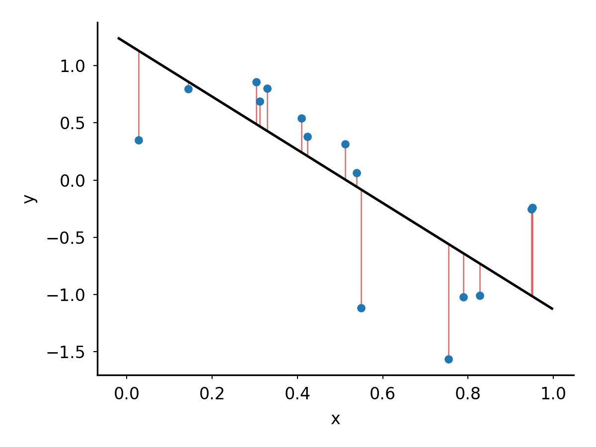

<details>

```bash
python src/train_line.py \
    --data out/train.tsv \
    --out_prefix out/line_train 
epoch 0000 mse=69.4646 w=+0.500 b=+8.000 dL/dw=+9.014 dL/db=+16.576
epoch 0001 mse=62.5277 w=+0.320 b=+7.668 dL/dw=+8.543 dL/db=+15.725
epoch 0002 mse=56.2873 w=+0.149 b=+7.354 dL/dw=+8.097 dL/db=+14.918
epoch 0005 mse=41.0803 w=-0.312 b=+6.504 dL/dw=+6.892 dL/db=+12.738
epoch 0010 mse=24.3574 w=-0.933 b=+5.354 dL/dw=+5.263 dL/db=+9.792
epoch 0020 mse=8.6993 w=-1.767 b=+3.790 dL/dw=+3.055 dL/db=+5.794
epoch 0050 mse=0.7158 w=-2.679 b=+1.984 dL/dw=+0.540 dL/db=+1.231
epoch 0100 mse=0.3560 w=-2.811 b=+1.505 dL/dw=-0.050 dL/db=+0.136
epoch 0200 mse=0.3349 w=-2.657 b=+1.378 dL/dw=-0.076 dL/db=+0.043
epoch 0300 mse=0.3228 w=-2.521 b=+1.303 dL/dw=-0.060 dL/db=+0.033
epoch 0500 mse=0.3105 w=-2.328 b=+1.196 dL/dw=-0.038 dL/db=+0.021
wrote out/line_train.params.tsv

python src/plot_fit.py \
        --data out/train.tsv \
        --w -2.328 \
        --b 1.196 \
        --residuals \
        -o img/line_train.residuals.png \
        -x x \
        -y y
```

</details>

To capture more of the pattern in the data, we can give the model more
parameters. Instead of using only $x$, we also include $x^2$, $x^3$, and so on,
and learn a separate weight for each.

$$ \hat{y} = b + w_1x + w_2x^2 + \dots + w_dx^d $$

Despite having more parameters, we can train the model using mean squared error
to measure how well the model fits the data and gradient descent to update the
parameters. The only difference is that we now have more weights to learn.

This is called polynomial regression, where $d$ is the degree of the
polynomial. A degree-$d$ polynomial has $d+1$ parameters, including the
intercept $b$.

## Training the model

As we increase the number of parameters, the model does a better job of
capturing the pattern, up to a point.

| Degree | Parameters | Train MSE | Fit |
|-|-|-|-|-|
| 1 | 2  | 0.3024 | 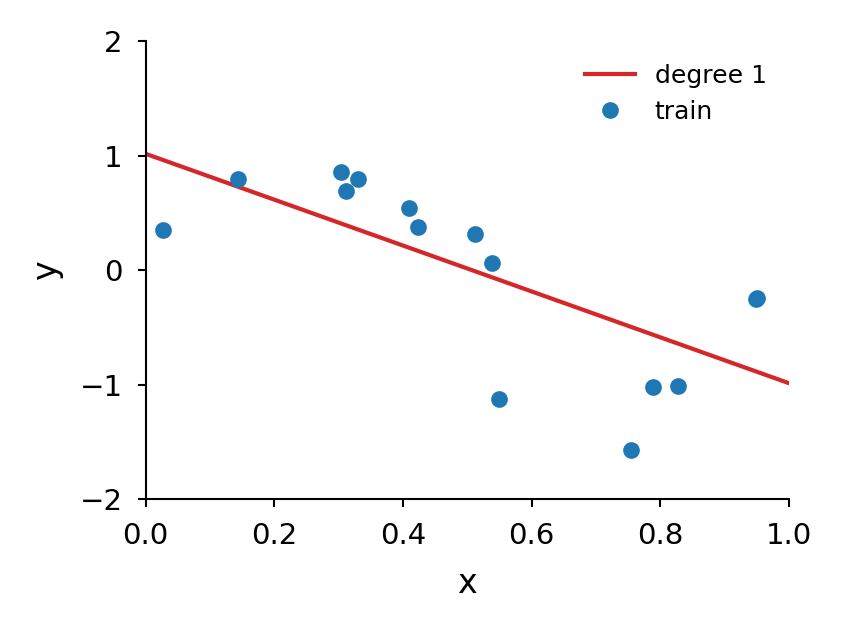 |
| 3 | 4  | 0.0811 | 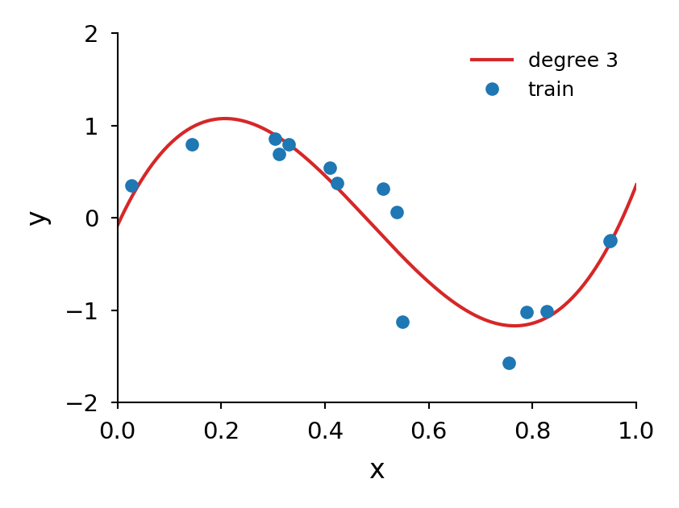 |
| 9 | 10 | 0.0408 | 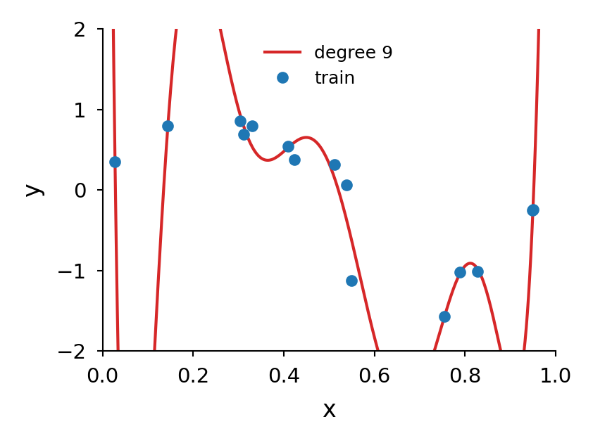 |

<details>

```bash
for d in 1 3 9; do
    python src/train_poly.py \
        --train out/train.tsv \
        --degree $d \
        --epochs 200000 \
        --out_prefix out/train_only_deg$d

    python src/plot_poly_fit.py \
        --train out/train.tsv \
        --weights out/train_only_deg$d.weights.tsv \
        --labels "degree $d" \
        -o img/train_only_deg$d.fit.png 
done
epoch 000000 train_mse=0.6035 val_mse=nan sum_w2=0.000
epoch 000010 train_mse=0.3896 val_mse=nan sum_w2=0.213
epoch 000100 train_mse=0.3024 val_mse=nan sum_w2=0.998
epoch 001000 train_mse=0.3024 val_mse=nan sum_w2=1.003
epoch 010000 train_mse=0.3024 val_mse=nan sum_w2=1.003
epoch 100000 train_mse=0.3024 val_mse=nan sum_w2=1.003
epoch 200000 train_mse=0.3024 val_mse=nan sum_w2=1.003
wrote out/train_only_deg1.curve.tsv out/train_only_deg1.weights.tsv
epoch 000000 train_mse=0.6035 val_mse=nan sum_w2=0.000
epoch 000010 train_mse=0.3053 val_mse=nan sum_w2=0.298
epoch 000100 train_mse=0.0826 val_mse=nan sum_w2=2.551
epoch 001000 train_mse=0.0811 val_mse=nan sum_w2=2.845
epoch 010000 train_mse=0.0811 val_mse=nan sum_w2=2.845
epoch 100000 train_mse=0.0811 val_mse=nan sum_w2=2.845
epoch 200000 train_mse=0.0811 val_mse=nan sum_w2=2.845
wrote out/train_only_deg3.curve.tsv out/train_only_deg3.weights.tsv
epoch 000000 train_mse=0.6035 val_mse=nan sum_w2=0.000
epoch 000010 train_mse=0.2867 val_mse=nan sum_w2=0.316
epoch 000100 train_mse=0.0722 val_mse=nan sum_w2=2.425
epoch 001000 train_mse=0.0573 val_mse=nan sum_w2=3.909
epoch 010000 train_mse=0.0504 val_mse=nan sum_w2=11.682
epoch 100000 train_mse=0.0409 val_mse=nan sum_w2=108.757
epoch 200000 train_mse=0.0408 val_mse=nan sum_w2=122.121
wrote out/train_only_deg9.curve.tsv out/train_only_deg9.weights.tsv
```

</details>

Moving from degree 1 (the straight line) to degree 3 allowed the model to
capture the general shape of the curve. But moving from degree 3 to degree 9
made things worse. Even though degree 9 has a lower MSE, it is fit to the
noise rather than the underlying pattern and swings wildly between the data
points.

This example is a special case because we know the true curve and noise level
that generated the data. A noise level of 0.3 means even the true curve has an
expected MSE of $0.3^2 = 0.09$, which we call the noise floor. The degree 3
polynomial gets close to this floor, while the degree 9 polynomial achieves a
much lower training MSE, suggesting that it is fitting the noise.

With real data, however, we don't know the true relationship or the noise
distribution, so we cannot calculate the noise floor. Without knowing what the
true relationship looks like, we need a way to tell whether a model is learning
the underlying pattern or just fitting the noise.

## Training, validation, and test data

To detect overfitting and estimate how well the model predicts data it has not
seen, divide our data into three sets:

- Training: Used to fit the model by updating its parameters.
- Validation: Used to measure how well the model predicts new data during
  training. Comparing training and validation MSE helps us detect overfitting.
- Test: Set aside until the very end to evaluate how well the final model
  performs on new data.

During training, we calculate MSE on both the training and validation sets, but
only use the training data to update the parameters. If training MSE continues
to decrease while validation MSE starts increasing, the model is overfitting.
We can use validation MSE to decide when to stop training and which model to
keep.

For this example we will use the split
- Training: 15 points
- Validation: 15 points
- Test: 200 test points.

| Training data | Validation data | Test data |
|-|-|-|
| 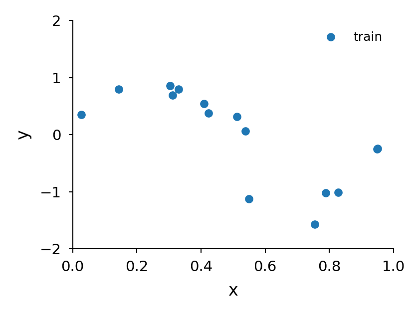 | 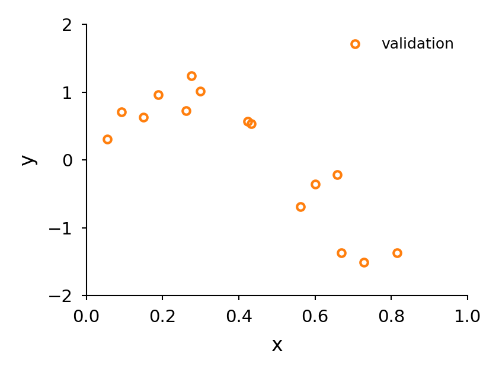 | 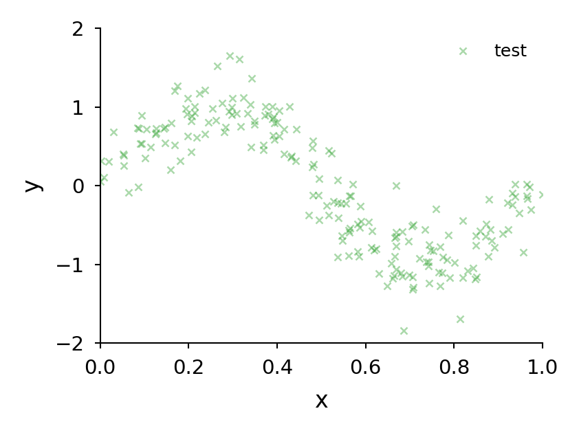 | 

<details>

```bash
python src/make_curve_dataset.py \
    --n 15 \
    --seed 1 \
    --out out/train.tsv
wrote out/train.tsv: 15 points, noise sd 0.3

python src/plot_poly_fit.py \
    --train out/train.tsv \
    -o img/train_data.png 

python src/make_curve_dataset.py \
    --n 15 \
    --seed 2 \
    --out out/val.tsv
wrote out/val.tsv: 15 points, noise sd 0.3

python src/plot_poly_fit.py \
    --val out/val.tsv \
    -o img/val_data.png 

python src/make_curve_dataset.py \
    --n 200 \
    --seed 3 \
    --out out/test.tsv
wrote out/test.tsv: 200 points, noise sd 0.3

python src/plot_poly_fit.py \
    --test out/test.tsv \
    -o img/test_data.png 
```

</details>

*Note*: These proportions are not typical of a training, validation, and test
split.  Normally, we would use most of our data for training. Here, we
intentionally use only 15 training points to make it easier for the model to
overfit, and a larger test set to demonstrate how overfitting affects
predictions on new data.

If we train the degree 1, 3, and 9 polynomials again, we can compare their
training and validation MSE to see which models are underfitting, which are
overfitting, and which are learning patterns that generalize to new data.

| Degree | Parameters | Train MSE | Validation MSE | Fit | Loss |
|-|-|-|-|-|
| 1 | 2  | 0.3024 | 0.3303 |  |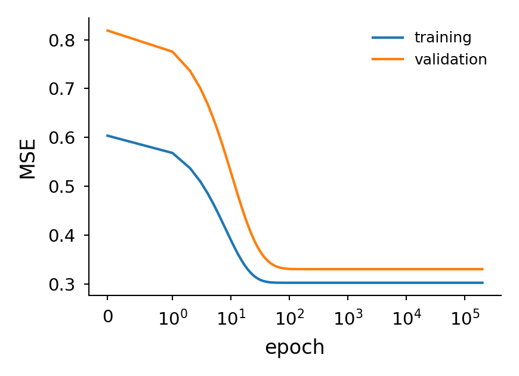 |
| 3 | 4  | 0.0811 | 0.0994 |  |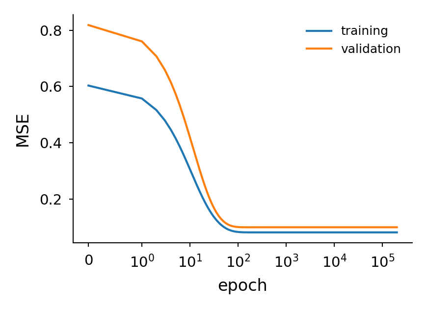 |
| 9 | 10 | 0.0408 | 5.0856 | 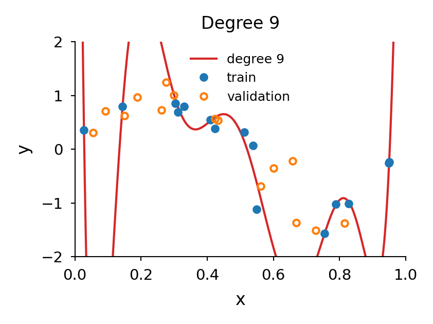 |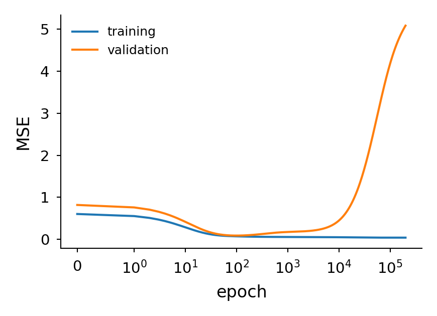 |

<details>

```bash
for d in 1 3 9; do
    python src/train_poly.py \
        --train out/train.tsv \
        --val out/val.tsv \
        --degree $d \
        --epochs 200000 \
        --out_prefix out/deg$d

    python src/plot_poly_fit.py \
        --train out/train.tsv \
        --val out/val.tsv \
        --weights out/deg$d.weights.tsv \
        --labels "degree $d" \
        -o img/deg$d.fit.png \
        --title "Degree $d"

    python src/plot_poly_loss.py \
        --curve out/deg$d.curve.tsv \
        --logx \
        -o img/deg$d.loss.png
done
epoch 000000 train_mse=0.6035 val_mse=0.8188 sum_w2=0.000
epoch 000010 train_mse=0.3896 val_mse=0.5284 sum_w2=0.213
epoch 000100 train_mse=0.3024 val_mse=0.3307 sum_w2=0.998
epoch 001000 train_mse=0.3024 val_mse=0.3303 sum_w2=1.003
epoch 010000 train_mse=0.3024 val_mse=0.3303 sum_w2=1.003
epoch 100000 train_mse=0.3024 val_mse=0.3303 sum_w2=1.003
epoch 200000 train_mse=0.3024 val_mse=0.3303 sum_w2=1.003
lowest val_mse=0.3303 at epoch 555
wrote out/deg1.curve.tsv out/deg1.weights.tsv
epoch 000000 train_mse=0.6035 val_mse=0.8188 sum_w2=0.000
epoch 000010 train_mse=0.3053 val_mse=0.4186 sum_w2=0.298
epoch 000100 train_mse=0.0826 val_mse=0.1000 sum_w2=2.551
epoch 001000 train_mse=0.0811 val_mse=0.0994 sum_w2=2.845
epoch 010000 train_mse=0.0811 val_mse=0.0994 sum_w2=2.845
epoch 100000 train_mse=0.0811 val_mse=0.0994 sum_w2=2.845
epoch 200000 train_mse=0.0811 val_mse=0.0994 sum_w2=2.845
lowest val_mse=0.0993 at epoch 148
wrote out/deg3.curve.tsv out/deg3.weights.tsv
epoch 000000 train_mse=0.6035 val_mse=0.8188 sum_w2=0.000
epoch 000010 train_mse=0.2867 val_mse=0.4169 sum_w2=0.316
epoch 000100 train_mse=0.0722 val_mse=0.0900 sum_w2=2.425
epoch 001000 train_mse=0.0573 val_mse=0.1758 sum_w2=3.909
epoch 010000 train_mse=0.0504 val_mse=0.4477 sum_w2=11.682
epoch 100000 train_mse=0.0409 val_mse=4.1811 sum_w2=108.757
epoch 200000 train_mse=0.0408 val_mse=5.0856 sum_w2=122.121
lowest val_mse=0.0900 at epoch 100
wrote out/deg9.curve.tsv out/deg9.weights.tsv
```

</details>


While training MSE decreased along with the degree of the polynomial,
validation MSE did not. Degree 9 had the lowest training MSE and the highest 
validation MSE. By comparing these two values, we can identify overfitting without
knowing the true curve or how much noise is in the data.

## Early stopping

Up to this point, we trained for a fixed number of epochs. But if a model
starts overfitting during training, continuing to update its parameters can
make its predictions worse.  Instead of choosing a set number of epochs, we can
use validation MSE to decide when to stop training. This is called early
stopping.

During training, we tracked validation MSE and saved the model's parameters
whenever it improved. After training, we kept the parameters from the epoch
with the lowest validation MSE.

If we train the degree 1, 3, and 9 polynomials again, this time using early stopping, we get the following results:

| Degree | Best epoch | Validation MSE | Fit |
|---|---:|---:|---|
| 1 | 555 | 0.3303 | 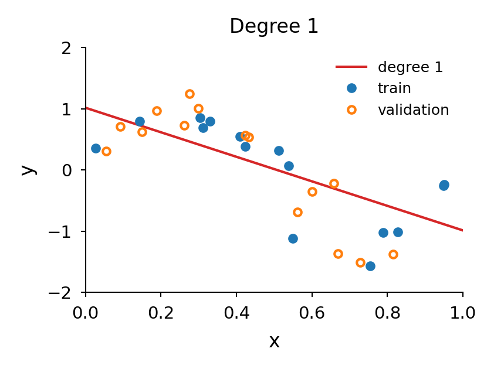 |
| 3 | 148 | 0.0993 | 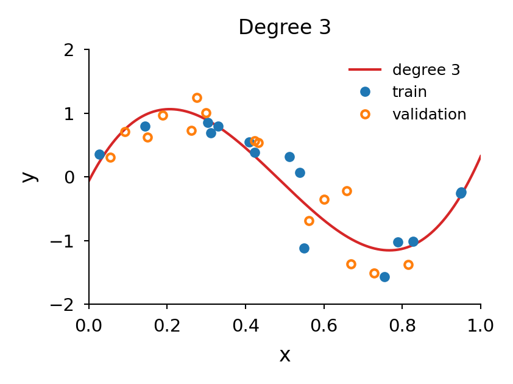 |
| 9 | 100 | 0.0900 | 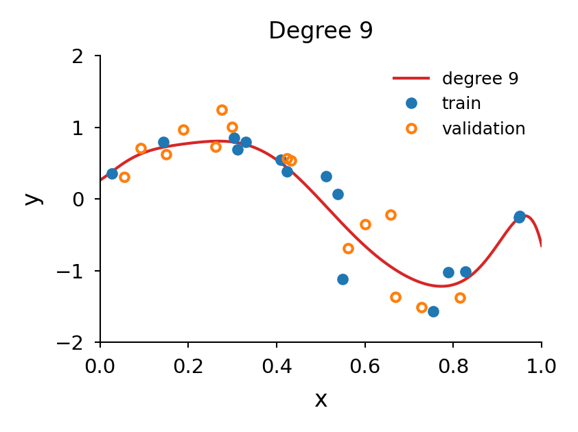 |

<details>

```bash
for d in 1 3 9; do
    python src/train_poly.py \
        --train out/train.tsv \
        --val out/val.tsv \
        --degree $d \
        --epochs 200000 \
        --early_stop \
        --out_prefix out/early_stop_deg$d

    python src/plot_poly_fit.py \
        --train out/train.tsv \
        --val out/val.tsv \
        --weights out/early_stop_deg$d.weights.tsv \
        --labels "degree $d" \
        -o img/early_stop_deg$d.fit.png \
        --title "Degree $d"

    python src/plot_poly_loss.py \
        --curve out/early_stop_deg$d.curve.tsv \
        --logx \
        -o img/early_stop_deg$d.loss.png
done
epoch 000000 train_mse=0.6035 val_mse=0.8188 sum_w2=0.000
epoch 000010 train_mse=0.3896 val_mse=0.5284 sum_w2=0.213
epoch 000100 train_mse=0.3024 val_mse=0.3307 sum_w2=0.998
epoch 001000 train_mse=0.3024 val_mse=0.3303 sum_w2=1.003
epoch 010000 train_mse=0.3024 val_mse=0.3303 sum_w2=1.003
epoch 100000 train_mse=0.3024 val_mse=0.3303 sum_w2=1.003
epoch 200000 train_mse=0.3024 val_mse=0.3303 sum_w2=1.003
lowest val_mse=0.3303 at epoch 555
epoch 000000 train_mse=0.6035 val_mse=0.8188 sum_w2=0.000
epoch 000010 train_mse=0.3053 val_mse=0.4186 sum_w2=0.298
epoch 000100 train_mse=0.0826 val_mse=0.1000 sum_w2=2.551
epoch 001000 train_mse=0.0811 val_mse=0.0994 sum_w2=2.845
epoch 010000 train_mse=0.0811 val_mse=0.0994 sum_w2=2.845
epoch 100000 train_mse=0.0811 val_mse=0.0994 sum_w2=2.845
epoch 200000 train_mse=0.0811 val_mse=0.0994 sum_w2=2.845
lowest val_mse=0.0993 at epoch 148
epoch 000000 train_mse=0.6035 val_mse=0.8188 sum_w2=0.000
epoch 000010 train_mse=0.2867 val_mse=0.4169 sum_w2=0.316
epoch 000100 train_mse=0.0722 val_mse=0.0900 sum_w2=2.425
epoch 001000 train_mse=0.0573 val_mse=0.1758 sum_w2=3.909
epoch 010000 train_mse=0.0504 val_mse=0.4477 sum_w2=11.682
epoch 100000 train_mse=0.0409 val_mse=4.1811 sum_w2=108.757
epoch 200000 train_mse=0.0408 val_mse=5.0856 sum_w2=122.121
lowest val_mse=0.0900 at epoch 100
```

</details>

Early stopping did not appreciably change degrees 1 and 3, where validation MSE
remained nearly constant after the models converged. But for degree 9, stopping
at epoch 100 gave a validation MSE of 0.0900, compared to 5.0856 after 200,000
epochs.

The degree-9 model has enough parameters to fit both the underlying pattern and
the noise. Early in training, it learned the general shape of the curve. As
training continued, it fit more of the noise, decreasing training MSE while
making predictions on new data worse.

By keeping the parameters from the epoch with the lowest validation MSE, we can
use a more complex model while limiting how much it overfits.

## L2 regularization

As we saw with the original degree-9 model, fitting noise can cause the model
to bend and oscillate sharply between data points. For a polynomial, this can
require large positive and negative weights.

Since overfitting can involve large weights, another way to limit it is to make
large weights costly. L2 regularization does this by adding the sum of the
squared weights to the loss function.

$$L = \text{MSE} + \lambda \sum_{j=1}^{d} w_j^2$$

$\lambda$ controls how strongly we penalize large weights. When $\lambda=0$,
there is no penalty. As $\lambda$ increases, the model is encouraged to use
smaller weights.  This loss function creates a tradeoff between reducing
MSE by fitting the training data more closely, and keeping the weights small.
The result can be a smoother curve that better captures the underlying pattern
rather than the noise.

To see the effect that L2 regularization can have, we trained the degree 9
polynomials again considering a range of $\lambda$ values:

| $\lambda$ | Train MSE | Validation MSE | $\sum w^2$ | Fit |
|-|-|-|-|-|
| 0      | 0.0408 | 5.0856 | 122.121 | 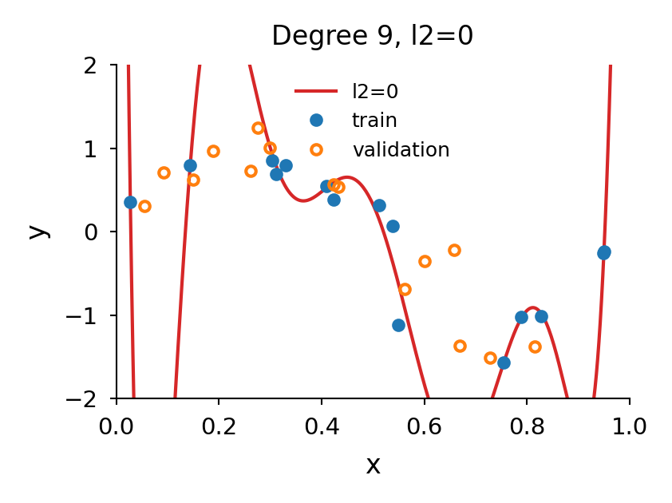 |
| 0.0001 | 0.0437 | 1.7067 | 45.608  | 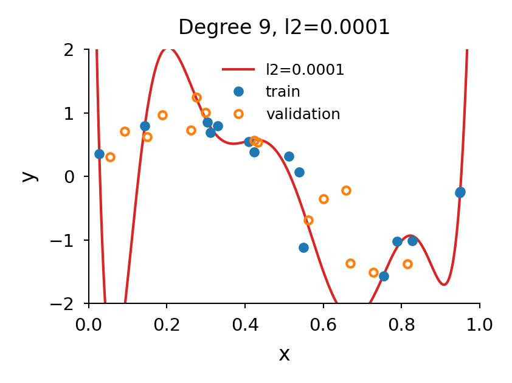 |
| 0.001  | 0.0541 | 0.2352 | 5.680   | 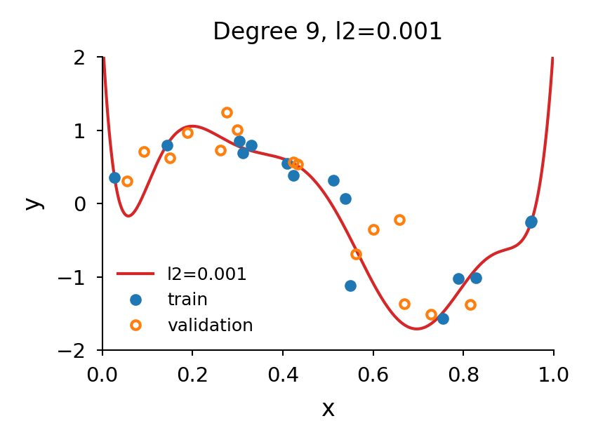 |
| 0.01   | 0.0621 | 0.1189 | 2.863   | 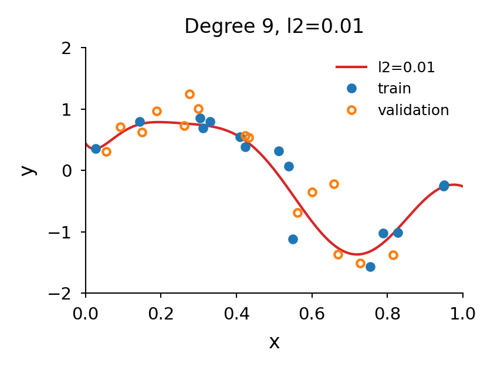 |
| 0.1    | 0.1315 | 0.1877 | 1.109   | 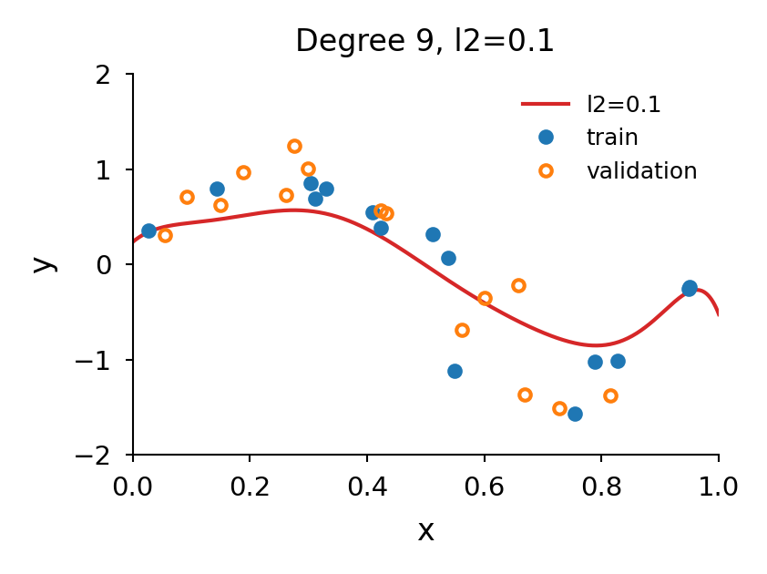 |
| 1      | 0.4240 | 0.6008 | 0.079   | 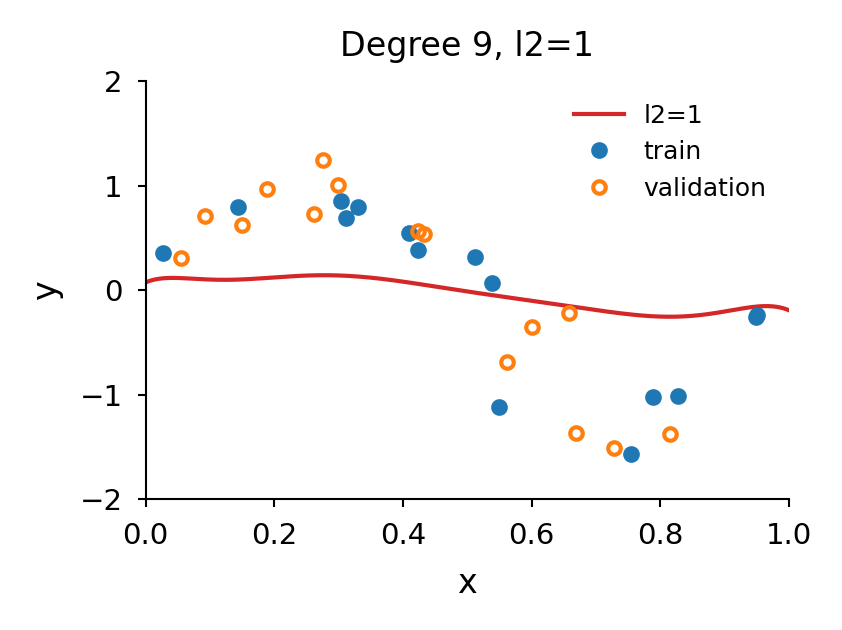 |

When $\lambda$ is too small, there is no pressure to keep the weights small, the
training and validation MSE diverge, and the model overfits. When $\lambda$ is too
large, there is too much pressure to keep the weights small, the model does not
have enough flexibility to capture the underlying pattern.

The lowest validation MSE among these models was at $\lambda=0.01$.
Increasing $\lambda$ beyond this point made the model too constrained to
capture the underlying pattern. We used validation data to choose this
hyperparameter.

<details>

```bash
for l2 in 0 0.0001 0.001 0.01 0.1 1; do
    python src/train_poly.py \
        --train out/train.tsv \
        --val out/val.tsv \
        --degree 9 \
        --l2 $l2 \
        --epochs 200000 \
        --out_prefix out/deg9_l2_$l2
done
epoch 000000 train_mse=0.6035 val_mse=0.8188 sum_w2=0.000
epoch 000010 train_mse=0.2867 val_mse=0.4169 sum_w2=0.316
epoch 000100 train_mse=0.0722 val_mse=0.0900 sum_w2=2.425
epoch 001000 train_mse=0.0573 val_mse=0.1758 sum_w2=3.909
epoch 010000 train_mse=0.0504 val_mse=0.4477 sum_w2=11.682
epoch 100000 train_mse=0.0409 val_mse=4.1811 sum_w2=108.757
epoch 200000 train_mse=0.0408 val_mse=5.0856 sum_w2=122.121
lowest val_mse=0.0900 at epoch 100
wrote out/deg9_l2_0.curve.tsv out/deg9_l2_0.weights.tsv
epoch 000000 train_mse=0.6035 val_mse=0.8188 sum_w2=0.000
epoch 000010 train_mse=0.2868 val_mse=0.4170 sum_w2=0.316
epoch 000100 train_mse=0.0723 val_mse=0.0900 sum_w2=2.422
epoch 001000 train_mse=0.0573 val_mse=0.1747 sum_w2=3.892
epoch 010000 train_mse=0.0510 val_mse=0.4008 sum_w2=10.332
epoch 100000 train_mse=0.0437 val_mse=1.6687 sum_w2=44.996
epoch 200000 train_mse=0.0437 val_mse=1.7067 sum_w2=45.608
lowest val_mse=0.0900 at epoch 100
wrote out/deg9_l2_0.0001.curve.tsv out/deg9_l2_0.0001.weights.tsv
epoch 000000 train_mse=0.6035 val_mse=0.8188 sum_w2=0.000
epoch 000010 train_mse=0.2869 val_mse=0.4172 sum_w2=0.315
epoch 000100 train_mse=0.0725 val_mse=0.0904 sum_w2=2.401
epoch 001000 train_mse=0.0575 val_mse=0.1655 sum_w2=3.750
epoch 010000 train_mse=0.0545 val_mse=0.2221 sum_w2=5.304
epoch 100000 train_mse=0.0541 val_mse=0.2352 sum_w2=5.680
epoch 200000 train_mse=0.0541 val_mse=0.2352 sum_w2=5.680
lowest val_mse=0.0904 at epoch 101
wrote out/deg9_l2_0.001.curve.tsv out/deg9_l2_0.001.weights.tsv
epoch 000000 train_mse=0.6035 val_mse=0.8188 sum_w2=0.000
epoch 000010 train_mse=0.2887 val_mse=0.4197 sum_w2=0.310
epoch 000100 train_mse=0.0754 val_mse=0.0956 sum_w2=2.203
epoch 001000 train_mse=0.0622 val_mse=0.1187 sum_w2=2.855
epoch 010000 train_mse=0.0621 val_mse=0.1189 sum_w2=2.863
epoch 100000 train_mse=0.0621 val_mse=0.1189 sum_w2=2.863
epoch 200000 train_mse=0.0621 val_mse=0.1189 sum_w2=2.863
lowest val_mse=0.0950 at epoch 116
wrote out/deg9_l2_0.01.curve.tsv out/deg9_l2_0.01.weights.tsv
epoch 000000 train_mse=0.6035 val_mse=0.8188 sum_w2=0.000
epoch 000010 train_mse=0.3062 val_mse=0.4439 sum_w2=0.267
epoch 000100 train_mse=0.1330 val_mse=0.1902 sum_w2=1.095
epoch 001000 train_mse=0.1315 val_mse=0.1877 sum_w2=1.109
epoch 010000 train_mse=0.1315 val_mse=0.1877 sum_w2=1.109
epoch 100000 train_mse=0.1315 val_mse=0.1877 sum_w2=1.109
epoch 200000 train_mse=0.1315 val_mse=0.1877 sum_w2=1.109
lowest val_mse=0.1877 at epoch 1430
wrote out/deg9_l2_0.1.curve.tsv out/deg9_l2_0.1.weights.tsv
epoch 000000 train_mse=0.6035 val_mse=0.8188 sum_w2=0.000
epoch 000010 train_mse=0.4330 val_mse=0.6118 sum_w2=0.070
epoch 000100 train_mse=0.4240 val_mse=0.6008 sum_w2=0.079
epoch 001000 train_mse=0.4240 val_mse=0.6008 sum_w2=0.079
epoch 010000 train_mse=0.4240 val_mse=0.6008 sum_w2=0.079
epoch 100000 train_mse=0.4240 val_mse=0.6008 sum_w2=0.079
epoch 200000 train_mse=0.4240 val_mse=0.6008 sum_w2=0.079
lowest val_mse=0.6008 at epoch 50
wrote out/deg9_l2_1.curve.tsv out/deg9_l2_1.weights.tsv

for l2 in 0 0.0001 0.001 0.01 0.1 1; do
    python src/plot_poly_fit.py \
        --train out/train.tsv \
        --val out/val.tsv \
        --weights out/deg9_l2_${l2}.weights.tsv \
        --labels "l2=$l2" \
        -o img/deg9_l2_${l2}.fit.png \
        --title "Degree 9, l2=${l2}"
done
```

</details>

## Train, validate, test

So far, training data was used to fit the model by adjusting its weights to
minimize the loss. Validation data was used to compare models and make
decisions about polynomial degree, regularization strength ($\lambda$), and
when to stop training. These decisions involved hyperparameters, which are
settings we chose rather than parameters learned during training.

Models are useful not because they fit training data, but because they can
make predictions about new data.  To measure this, we use a test
data set that has not been used to train the model or make decisions about it.
By comparing the model's predictions to the actual values in the test set,
we can estimate how well the model would perform on new data.

One possible outcome is that performance on the test set is worse than
expected, and we might be tempted to go back and change the model. The
problem is that we would now be using the test data to make design decisions.
If we kept doing this, we could overfit to the test set and no longer have an
independent estimate of how well the model performed on new data. We could
investigate what went wrong and improve the model, but we would need a new
independent test set to evaluate it.

Here we retained 200 points for our test set. We selected our model using
validation MSE, but for this exercise we also evaluated the other models on
the test set to see how their performance compared.

| Model | Train MSE | Validation MSE | Test MSE |
|-|-|-|-|
| degree 1                   | 0.3024 | 0.3303 | 0.2839 |
| degree 3                   | 0.0811 | 0.0994 | 0.1134 |
| degree 9                   | 0.0408 | 5.0856 | 8.4781 |
| degree 9, early stopping   | 0.0722 | 0.0900 | 0.1019 |
| degree 9, $\lambda = 0.01$ | 0.0621 | 0.1189 | 0.1223 |

The degree-9 model with early stopping had the lowest validation MSE, so it
was the model we selected. Its test MSE wa slightly higher than its
validation MSE, wich could reflect random variation in the data or some
overfitting to the validation set.

<details>

```bash
for f in deg1 deg3 deg9 early_stop_deg9 deg9_l2_0.01; do
    echo $f
    python src/eval_poly.py \
        --weights out/$f.weights.tsv \
        --data out/train.tsv out/val.tsv out/test.tsv
done
deg1
out/train.tsv	mse=0.3024
out/val.tsv	mse=0.3303
out/test.tsv	mse=0.2839
deg3
out/train.tsv	mse=0.0811
out/val.tsv	mse=0.0994
out/test.tsv	mse=0.1134
deg9
out/train.tsv	mse=0.0408
out/val.tsv	mse=5.0856
out/test.tsv	mse=8.4781
early_stop_deg9
out/train.tsv	mse=0.0722
out/val.tsv	mse=0.0900
out/test.tsv	mse=0.1019
deg9_l2_0.01
out/train.tsv	mse=0.0621
out/val.tsv	mse=0.1189
out/test.tsv	mse=0.1223
```

</details>

## Questions

1. We trained polynomials with degrees 1, 3, and 9.  What happens if we use
   degree 5? Train a degree-5 polynomial using the same training and
   validation data for 200,000 epochs.

   ```bash
   python src/train_poly.py \
       --train out/train.tsv \
       --val out/val.tsv \
       --degree 5 \
       --epochs 200000 \
       --out_prefix out/deg5
   ```

   Compare its training and validation MSE to the other models. Did
   increasing the degree from 3 to 5 improve predictions on the
   validation data? Did it overfit?

2. Our original training set had only 15 points.  Generate a new training set
   with 150 points and train a degree-9 polynomial using the same validation
   set.

   ```bash
   python src/make_curve_dataset.py \
       --n 150 \
       --seed 1 \
       --out out/train150.tsv

   python src/train_poly.py \
       --train out/train150.tsv \
       --val out/val.tsv \
       --degree 9 \
       --epochs 200000 \
       --out_prefix out/deg9_train150
   ```

   Compare the training and validation MSE to the original degree-9 model.
   Did increasing the amount of training data reduce overfitting? Why
   might more training data help?

3. We tried several values of $\lambda$, but what happens between 0.001 and
   0.01? Train the degree-9 model using $\lambda=0.005$.

   ```bash
   python src/train_poly.py \
       --train out/train.tsv \
       --val out/val.tsv \
       --degree 9 \
       --l2 0.005 \
       --epochs 200000 \
       --out_prefix out/deg9_l2_0.005
   ```

   Compare its training MSE, validation MSE, and sum of squared weights
   to the results for $\lambda=0.001$ and $\lambda=0.01$. Which value
   would you choose based on validation MSE?
